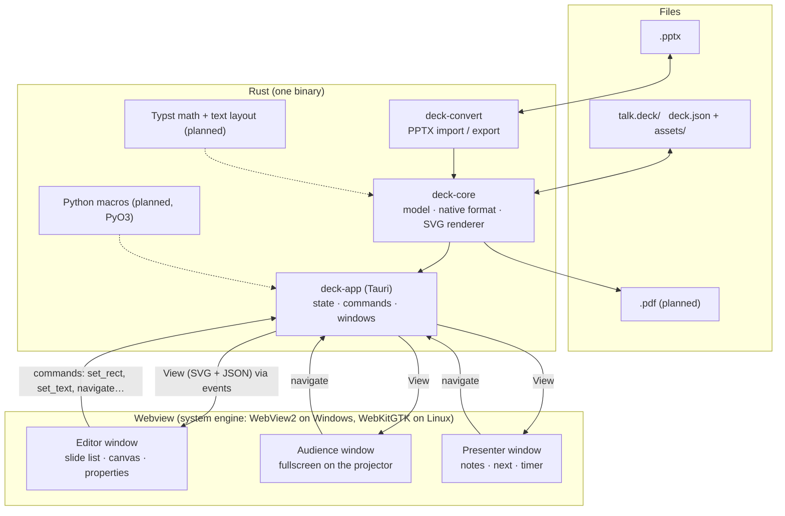
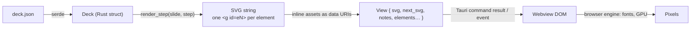
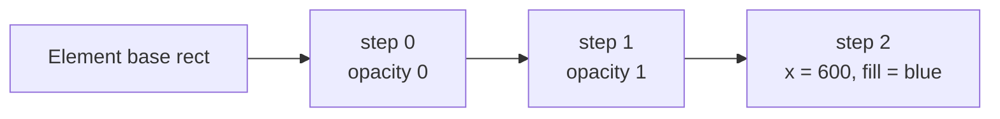
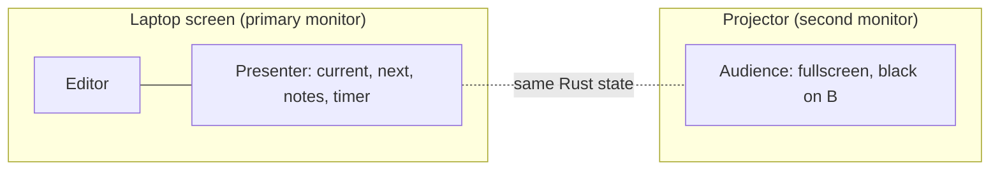

# Architecture

decker is a Rust workspace with a web front-end. Rust holds the truth: the document model,
the file formats, the renderer, and during a presentation the current slide and step. The
front-end only draws what Rust sends and turns user actions into commands.

## The stack



Three crates and one app:

| Part | Language | Role |
| --- | --- | --- |
| `crates/deck-core` | Rust | `Deck` → `Slide` → `Element` (text, image, shape, math), build steps, JSON on disk, SVG renderer |
| `crates/deck-convert` | Rust | Library and CLI: PPTX ↔ deck, SVG render |
| `apps/deck-app/src-tauri` | Rust | Tauri application: state, commands, the three windows |
| `apps/deck-app/src` | Svelte + TypeScript | The three views, served in the webview |

## From a file to pixels



The renderer is a pure function of the model and the step. The same SVG serves the editor
canvas, the audience window, the presenter preview, the thumbnails, and later the PDF export.

## One source of truth

```mermaid
sequenceDiagram
    participant P as Presenter window
    participant R as Rust state (Mutex&lt;AppState&gt;)
    participant A as Audience window
    participant E as Editor window
    P->>R: navigate("next")
    R->>R: step += 1, or slide += 1
    R-->>P: View
    R-)A: event "view-changed"
    R-)E: event "view-changed"
    A->>R: get_view()
    R-->>A: View (SVG at the new step)
    E->>R: get_view()
    R-->>E: View
```

Every window subscribes to `view-changed` and re-fetches the view. Windows never talk to each
other, and no window keeps state of its own beyond what it is drawing. The future Python API
calls the same state functions as the commands, so a macro and the editor cannot disagree.

## Build steps



An element carries a list of steps; each one is a set of overrides (x, y, w, h, rotation,
opacity, fill) with a duration, delay and easing. `state_at(step)` applies the overrides in
order. Appear, disappear, move, grow, spin and recolor are one mechanism. The audience window
patches the existing `<g>` elements between steps, so the browser engine transitions opacity
and rotation in place; positions snap for now.

## Presentation windows



`start_presentation` lists the monitors: the audience window goes fullscreen on the first
non-primary one, the presenter window on the primary. With a single monitor only the
audience window opens. Keys handled in every window: arrows, Page Up/Down, Space, Enter,
Home, End, B, Escape.

## Why these choices

- **Rust for the engine**: one fast binary on Linux and Windows, no runtime to install, and
  PyO3 lets Python be embedded for macros later.
- **Tauri rather than a native toolkit**: slides are text, images and shapes on a rectangle,
  which HTML and SVG render better than any widget toolkit, with fonts and GPU acceleration
  for free. Tauri uses the webview the OS already ships, so the installer stays small.
- **Svelte + TypeScript for the views**: the closest thing to plain HTML, small output, and
  the types mirror the Rust `View` so the two sides cannot drift silently.
- **JSON in a folder**: readable, diffable, and trivial to script. A zipped single file is
  the same layout archived.
- **PPTX as a converter, not the native format**: import what can be expressed, warn about
  the rest, and never let PowerPoint's model dictate ours.
