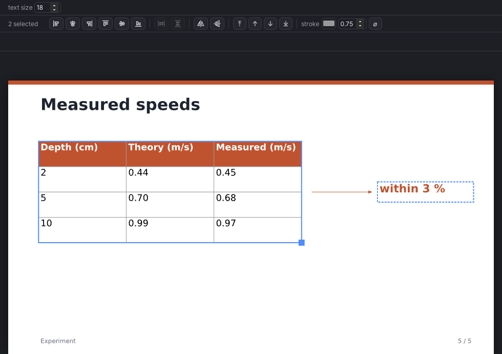

# Arranging

## Selecting

- Click an element to select it; Shift+click adds or removes one from the selection.
- Drag on the empty slide: a rubber band selects every element it touches.
- Click the empty slide to clear the selection; Delete removes the selected element.

### Names

The panel of a selected element starts with its **name**: type one to tell the element apart
in the [animation timeline](steps.md) ("Speed arrow" rather than "Shape"). Without a name,
lists show its kind and the start of its text. Names travel to PowerPoint and back, where they
appear in the Selection Pane; the names PowerPoint makes up ("TextBox 3") are not imported.

## Moving, resizing, rotating

- Drag to move the whole selection. Its edges and center snap to the slide's edges and center
  and to those of the other elements, with a dashed guide where it snapped; hold Alt to move
  freely.
- Drag the corner handle to resize.
- The round handle above a selected element rotates it (Shift for steps of 15°; it catches at
  right angles; double-click to reset).
- The side panel edits position and size as numbers.

Viewing a later click of a slide with [build steps](steps.md), moving, resizing or rotating
sets where the element is at that click, as a step.

## The arrange bar

Under the style bar, for any selection:

- **Align** left, center, right, top, middle or bottom: to the selection's bounds, or to the
  slide when one element is selected.
- **Distribute** three or more elements with equal gaps, horizontally or vertically.
- **Mirror** left to right or top to bottom: lines and arrows turn, pictures are drawn
  mirrored, groups mirror their content, text stays readable.
- **Order**: bring to front, forward, backward, send to back.
- **Stroke** color and width of shapes, text boxes and table rules.

## Groups

Shift+click several elements, then **Group** (Ctrl+G): they become one element that moves,
resizes and animates together. **Ungroup** (Ctrl+Shift+G) takes it apart. PowerPoint groups
import as groups, with their animations on the group.

## Copy, cut, paste, undo

- Ctrl+C and Ctrl+X copy or cut the selected elements, Ctrl+V pastes them, slightly offset, on
  the current slide or layout, in this deck or in another running copy of decker. Within a
  deck pasted pictures share the file in `assets/`; across decks the file is copied once.
- Ctrl+Z undoes any edit of the deck and Ctrl+Y (or Ctrl+Shift+Z) redoes it, also from the
  ↶ ↷ toolbar buttons; a run of typing in one box counts as one step. Opening a deck clears
  the history; saving does not.
