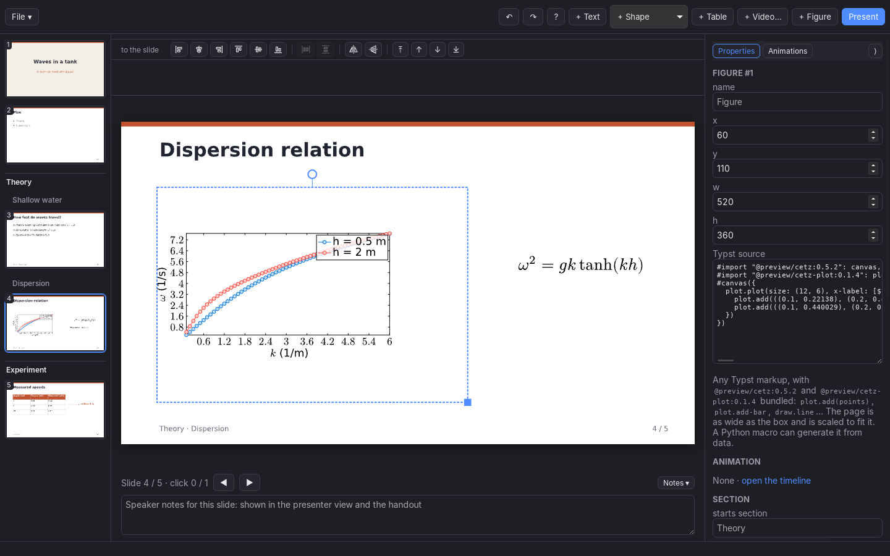

# The editor at a glance

The editor is one window in five areas.



```text
┌────────────────────────────────────────────────────────────────────────────┐
│ ① File ▾                                                          ↶ ↷ ?    │
│ ② + Text + Shape + Table + Video… + Figure                       Present     │
├──────────┬──────────────────────────────────────────────┬──────────────────┤
│ ③        │ ④ style bar · arrange bar                    │ ⑤ Properties │   │
│ thumb-   │ ┌──────────────────────────────────────────┐ │   Animations  ⟩  │
│ nails,   │ │                                          │ │ name, position,  │
│ sections │ │               the slide                  │ │ section, layout, │
│          │ │                                          │ │ fonts and colors │
│          │ └──────────────────────────────────────────┘ │ — or the         │
│          │  ◀ click 0 / 2 ▶                    Notes ▾  │ timeline         │
│          │ ⑥ speaker notes                              │                  │
└──────────┴──────────────────────────────────────────────┴──────────────────┘
```

1. **The deck bar**: the **File** menu (new, open, save, insert slides from another deck,
   export; Ctrl+N, Ctrl+O, Ctrl+S, Ctrl+Shift+S); undo and redo; **?** opens the list of
   [commands and keys](keys.md) (also **F1**).
2. **The insert bar**: add elements to the slide, start the
   presentation. While a layout is being edited, it holds the layout's own commands
   (placeholders, save and load, **Done**).
3. **The thumbnail pane**: one thumbnail per slide under its section headers. Click to go,
   drag to reorder; right-click a thumbnail to add, duplicate or delete slides, or between
   thumbnails to add a slide, a plan slide or a section; see [Slides and sections](slides.md).
4. **The canvas**: the current slide, edited directly. Above it, the **style bar** (font,
   size, color, alignment, bullets, fill and outline) and the **arrange bar** (align,
   distribute, mirror, order, stroke) act on the selection; below it, **◀ ▶** show the slide
   at a given click of its [build steps](steps.md).
5. **The side panel**, in two tabs. **Properties**: without a selection, the slide's
   section, layout, fonts and colors and the macros; with one, its name, position and size
   and what belongs to its kind (crop for an image, playback for a video, cells for a table,
   source for a formula, points for a path). **Animations**: the slide's
   [timeline](steps.md#the-timeline) and the selected element's steps. **⟩** collapses the
   panel to a strip of its two tabs, for a larger slide; clicking a tab opens it again.
6. **The notes**: the slide's speaker notes, under the slide; **Notes ▾** folds them away.
   decker remembers whether the panel and the notes are open.

## Selecting and editing

Click an element to select it, Shift+click to add to the selection, drag on an empty spot of
the slide to select everything the rubber band touches. Drag to move (edges and centers snap,
Alt moves freely), drag the corner handle to resize, the round handle above to rotate. See
[Arranging](arranging.md).

Double-click a text box, a shape or a table cell to type in it; Escape ends editing. See
[Text](text.md).

Every change is one undo step (Ctrl+Z, Ctrl+Y); a run of typing in one box counts as one.
