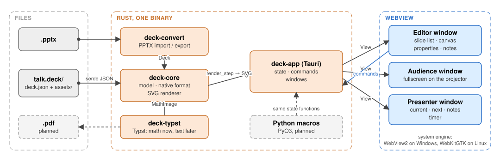

# decker

A free, fast, modern alternative to PowerPoint, written in Rust, for Linux and Windows.

- **Reads and writes PPTX** through a converter that imports what can be expressed and says
  what it skipped, so decks from colleagues open and go back to them.
- **Presents** on a projector with a presenter view: current slide, what comes next, notes,
  timer, black screen.
- **Build steps** reveal, move, grow or recolor elements click by click, with one mechanism.
- **Formulas** in Typst or LaTeX syntax (rendering engine planned).
- **Python macros** (planned) see the same document model as the editor.

Status: first draft. The document model, the native format, an SVG renderer, the PPTX
converter and the application with its three windows exist. See the [roadmap](roadmap.md).

