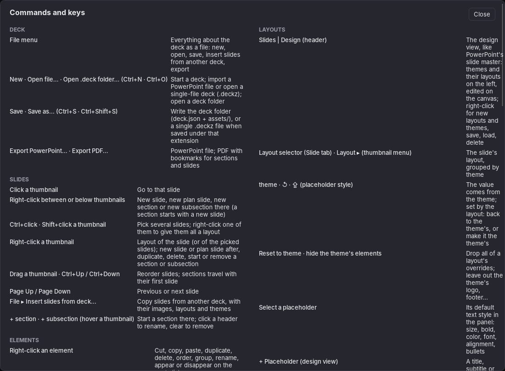

# Commands and keys

The same list as the editor's help (**F1** or **?**). Generated from the editor's source by
`docs/gen_keys.py`; do not edit by hand.

## Deck

| Key or control | Does |
| --- | --- |
| File menu | Everything about the deck as a file: new, open, save, insert slides from another deck, export |
| New · Open file… · Open .deck folder… (Ctrl+N · Ctrl+O) | Start a deck; import a PowerPoint file or open a single-file deck (.deckz); open a deck folder |
| Save · Save as… (Ctrl+S · Ctrl+Shift+S) | Write the deck folder (deck.json + assets/), or a single .deckz file when saved under that extension |
| Export PowerPoint… · Export PDF… | PowerPoint file; PDF with bookmarks for sections and slides |

## Slides

| Key or control | Does |
| --- | --- |
| Click a thumbnail | Go to that slide |
| Right-click between or below thumbnails | New slide, new plan slide, new section or new subsection there (a section starts with a new slide) |
| Ctrl+click · Shift+click a thumbnail | Pick several slides; right-click one of them to give them all a layout |
| Right-click a thumbnail | Layout of the slide (or of the picked slides); new slide or plan slide after, duplicate, delete, start or remove a section or subsection |
| Drag a thumbnail · Ctrl+Up / Ctrl+Down | Reorder slides; sections travel with their first slide |
| Page Up / Page Down | Previous or next slide |
| File ▸ Insert slides from deck… | Copy slides from another deck, with their images, layouts and themes |
| + section · + subsection (hover a thumbnail) | Start a section there; click a header to rename, clear to remove |

## Elements

| Key or control | Does |
| --- | --- |
| Right-click an element | Cut, copy, paste, duplicate, delete, order, group, rename, appear or disappear on the next click |
| Ctrl+D · T · R | Duplicate the selection; add a text box; add a rectangle |
| Click · Shift+click | Select; add to the selection; drag to move; corner handle to resize; Delete to remove |
| Drag on the empty slide | A rubber band: selects every element it touches |
| Round handle above the selection | Rotates the element (Shift: steps of 15°; it catches at 0, 90, 180, 270); double-click to reset. At a later click it makes a rotation step |
| Drag | Moves the whole selection; edges and centers snap to the slide and to other elements, with a guide line (hold Alt to move freely) |
| Arrange bar | Align to the selection (or to the slide for one element), distribute with equal gaps, mirror, bring forward or send back, stroke color and width |
| Group · Ungroup (Ctrl+G · Ctrl+Shift+G) | Several elements become one, moved, resized and animated together |
| + Table | A table with a header row; double-click a cell to type in it (Tab: next cell); rows, columns, widths and fills in the panel, the rules in the arrange bar |
| + Shape | A rectangle, an ellipse, a line or an arrow in the theme's accent color; the style bar sets fill, outline and, for lines, the direction |
| + Shape ▸ Freehand · Bézier path | Drag to draw freehand; or click corners and drag curves; end on the first point to close it into a shape (Enter: leave it open) |
| Double-click a path | Edit its points: drag points and handles (Alt: break a smooth point), double-click a point for corner / curve, Delete removes it, Escape ends |
| + Text · + Figure | A text box; a Typst figure (CeTZ plots and drawings) edited as source |
| Ctrl+Z · Ctrl+Y (or Ctrl+Shift+Z) | Undo and redo any edit of the deck; a run of typing in one box is one step |
| Ctrl+C · Ctrl+X · Ctrl+V | Copy or cut the selected elements; paste them (also into another deck or slide, images shared within a deck, copied across decks), a clipboard image, or text into the box being edited |
| Drop a file · + Video… | Drop image, video or GIF files on the canvas where they should go, or pick a clip |
| Playback (panel) | A video or GIF plays when it appears or on its play button, looping or once; sound off by default |
| Double-click a text | Edit in place: type, Backspace/Delete, arrows, Home/End, Shift+arrows to select, Ctrl+A |
| Mouse in a text being edited | Click places the caret, drag selects, double-click selects a word, triple-click a paragraph |
| Enter · Escape | New paragraph · finish editing |
| Alt+= | Inline formula: types $$ with the caret inside (while editing text) |
| Ctrl+B · Ctrl+I | Bold · italic (selection, or the whole box when not editing) |
| Style bar | Size, color, font, alignment, bullets; fill and outline of boxes and shapes; plan colors |
| Image panel | Crop to a shape; percentage cut from each edge |
| Animations tab | The timeline: one row per click; drag an entry to another click, or between two for a click of its own. Then the selected element's steps: appear or disappear on click, move steps (drag the element while viewing the step), rotation, fill, timing |
| Properties ▸ name | A name for the selected element, shown in the timeline and kept in PowerPoint |
| ⟩ (side panel) · « (slides) · Notes ▾ | Collapse the side panel or the slides (drag the slides' edge to resize them); fold the notes under the slide: more room for the slide |
| Element · Slide · Animations (side panel) | The selection's settings; the slide's (section, layout, theme, fonts and colors, macros); the timeline |
| Fit · 100% · − + (status bar) · Ctrl+0 · Ctrl+- · Ctrl++ | Zoom: fit the slide in the window, actual size, out, in |
| ◀ ▶ under the canvas | View the slide at a given click |

## Layouts

| Key or control | Does |
| --- | --- |
| Slides \| Design (header) | The design view, like PowerPoint's slide master: themes and their layouts on the left, edited on the canvas; right-click for new layouts and themes, save, load, delete |
| Layout selector (Slide tab) · Layout ▸ (thumbnail menu) | The slide's layout, grouped by theme |
| theme · ↺ · ⇪ (placeholder style) | The value comes from the theme; set by the layout: back to the theme's, or make it the theme's |
| Reset to theme · hide the theme's elements | Drop all of a layout's overrides; leave out the theme's logo, footer… |
| Select a placeholder | Its default text style in the panel: size, bold, color, font, alignment, bullets |
| + Placeholder (design view) | A title, subtitle or body slot new slides start from |
| `{{section}}` `{{subsection}}` `{{slide}}` `{{slides}}` `{{title}}` `{{deck}}` `{{date}}` | Variables in layout texts, filled per slide |
| Fonts and colors (panel) | Default font, size, text color, accent and palette of the slide's theme, of the theme or of the layout under edit; fonts/ in the deck adds fonts |

## Macros

| Key or control | Does |
| --- | --- |
| Macros (panel) · Run script… | Python scripts in the deck's scripts/ folder, or any .py file, run against the open deck with the decker package; the result is one undo step |

## Presenting

| Key or control | Does |
| --- | --- |
| P (presenter window) · Pointer button | Mirror the mouse over the current slide as a red dot on the audience window |
| D · C (presenter window) · Pen button | Draw on the current slide, shown to the audience; C or leaving the slide erases it |
| Present (Shift+F5) · F5 · Esc | From this slide · from the start: fullscreen on the projector, presenter view on the laptop · end |
| Right / Down / Space / Enter / click · Left / Up / Backspace | Next · previous step or slide |
| Home · End | First · last slide |
| B · W | Black · white screen (write on the whiteboard) |

## Everywhere

| Key or control | Does |
| --- | --- |
| F1 · ? | This help |
