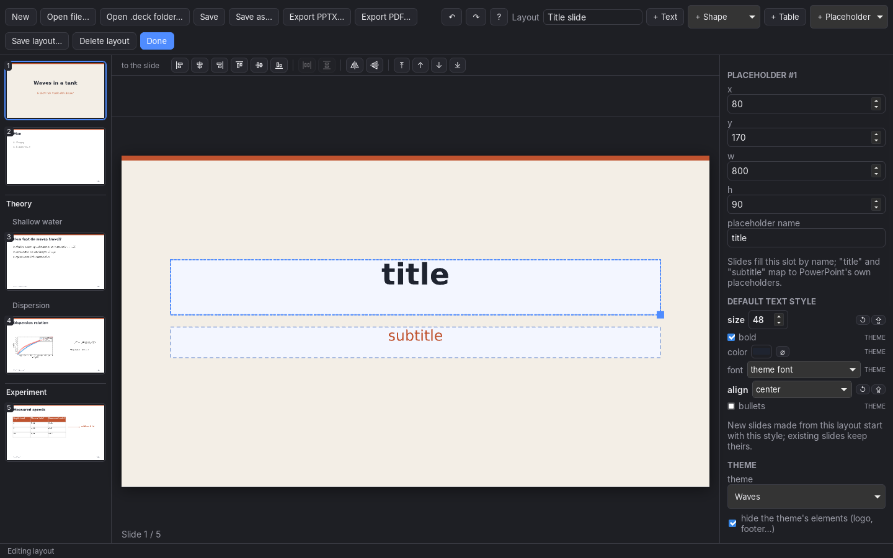

# Themes and layouts

A **theme** is what a family of slides shares: a background, elements drawn on every slide (a
logo, a footer, a band), a text style (fonts, colors, palette), and the style of each kind of
placeholder (title, subtitle, body). A **layout** belongs to a theme and gives one
arrangement of placeholders: title slide, title and content, two contents… It keeps **only
what it changes** of its theme, so a change to the theme reaches every layout that did not
change that very thing, and anything a layout changes shows as an override that one click
takes back.

A slide names its layout. A deck can have several themes, for instance after pasting slides
from another deck.



## Choosing a slide's layout

- Right-click a thumbnail, **Layout ▸**, and pick one (the list is grouped by theme). To give
  several slides the same layout, pick them first with Ctrl+click or Shift+click on their
  thumbnails.
- The right panel shows the slide's layout, with a selector to change it. Changing it keeps
  the slide's elements; placeholders are not re-created.
- **New slide** (right-click a thumbnail) creates the next slide from that slide's layout:
  one text box per placeholder, at the placeholder's position and in its style, showing the
  placeholder's name.

## Editing a layout

**Edit layout**, under the layout selector, shows the layout on the canvas instead of a
slide: its theme's elements, dimmed and not selectable; its own elements, editable like slide
elements; and its placeholders as dashed boxes with their name, which move and resize the
same way and are renamed in the panel (slides that fill the placeholder follow the new name).
**+ Text**, **+ Shape**, **+ Table** and **+ Placeholder** add elements, **Delete layout**
removes the layout (its slides keep their elements), the name field renames it, **Done**
returns to the slides.

Selecting a placeholder shows its text style in the panel: size, bold, color, font,
alignment, bullets. In a layout with a theme, each field says where its value comes from:

- **theme**: the theme's value, which follows the theme when it changes;
- in bold, with **↺** and **⇪**: set by this layout. **↺** drops the override and returns to
  the theme's value; **⇪** makes this value the theme's, for all its layouts.

The panel's **Theme** section shows the layout's theme (a selector moves the layout to
another theme, or to none, keeping its look), **hide the theme's elements** (for a title
slide without the footer, say), and what the layout changes of its theme, with
**Reset to theme** to drop every override at once. Placeholder positions and the layout's
own elements are its own, not overrides.

## Editing a theme


**Edit theme** (next to **Edit layout**, or from the layout editor) shows the theme: its
background and its elements on the canvas, editable like a layout's. The panel holds the
**placeholder styles**, one per kind (`title`, `subtitle`, `body`…, a body style serving
`body1`, `body2`…), the theme's **text style**, and buttons to open each of its layouts. The
name field renames the theme, **Delete theme** removes it (its layouts keep their look and
lose the theme), **Done** returns to the slides. **+ New theme**, under the layout selector,
starts one with the usual placeholder styles.

## Creating a layout

**+ New layout** offers PowerPoint's usual dispositions: title slide (title and subtitle),
title and content, section header, two contents, comparison (two headings over two bodies),
title only, and blank. The new layout joins the theme of the current slide's layout (or the
deck's first theme) and takes its placeholder styles. Its placeholders are named `title`,
`subtitle`, `heading1`, `body1`… In the layout editor, **+ Placeholder** adds a title, a
subtitle or a body, named the same way (`subtitle2` for a second one).

## Text style: fonts and colors

A text style is a default font, text size, text color, an accent and a palette of swatches.
The deck has one; a theme may set its own, and a layout its own over the theme's; each
fills only what it sets, so blank fields inherit (layout, then theme, then deck).

- Text, formulas and placeholders that set no font, size or color of their own take the
  style in force. Changing a theme's font restyles every slide of its layouts. Runs keep an
  explicit style wherever one was set; the style bar's ⌀ buttons return to the inherited
  one.
- The accent is the default highlight of the plan slide and the first swatch; the swatches
  appear as round buttons in the style bar.
- The **Text style** section of the right panel edits the deck's style on a slide, the
  theme's in the theme editor and the layout's in the layout editor.
- Fonts: the bundled families are DejaVu Sans (default), Libertinus Serif, New Computer
  Modern and DejaVu Sans Mono. Any `.ttf` or `.otf` file in the deck's `fonts/` folder is
  loaded with the deck and listed by its family name, so a corporate font travels with the
  deck and the PDF export embeds it. A missing family falls back to DejaVu Sans.

## Variables

A theme's or a layout's texts can hold variables filled per slide, such as a footer
`{{section, " | ", subsection}}` and `{{slide, " / ", slides}}`. The list and the rules are
in [Variables](variables.md).

## Reusing a layout: `.deck_layout`

**Save layout…** in the layout editor writes the layout, merged with its theme so that it
stands on its own, as a folder:

```text
Corp.deck_layout/
  layout.json   # the layout: background, elements, placeholders, text style
  assets/       # its images
```

**Load layout…** (under the layout selector) reads such a folder into the current deck,
copying its images, under its name or a numbered one if the name is taken, and opens it for
editing; it has no theme until one is chosen in its panel. A folder of `.deck_layout` folders
is a layout library. The deck must have been saved once, so that images have a folder to be
copied into. Slides pasted or inserted from another deck bring their layout and its theme
along when the deck lacks them (see [Reusing work](reuse.md)).

## PowerPoint

**Import** makes one theme of each slide master: what all its layouts share (the master's
background, shapes, fonts and colors, and per kind of placeholder the most common style)
goes into the theme, named after the PowerPoint theme, and each layout keeps its
differences as overrides. Date, footer and slide-number placeholders are skipped; a blank
layout is not kept. Slides keep their layout and their placeholder names.

**Export** writes one PowerPoint layout per decker layout, merged with its theme, under one
slide master, plus a blank layout for slides without one. Text boxes that fill a
placeholder are exported as placeholders of that layout, so the deck opens in PowerPoint
with its layouts in the layout gallery; the deck's text style becomes the PowerPoint theme
(minor and major font, `dk1` text color, `accent1`–`accent6`).

```bash
deck-convert layouts talk.deck
```

lists a deck's themes, their layouts, what each layout overrides, and its placeholders.

## In `deck.json`

```json
{
  "themes": [
    {
      "name": "Corp",
      "background": "#FFFFFF",
      "style": { "font": "Libertinus Serif", "color": "#223344", "accent": "#AA0000" },
      "elements": [
        { "type": "shape", "rect": { "x": 0, "y": 500, "w": 960, "h": 40 }, "fill": "#102030" }
      ],
      "placeholders": [
        { "name": "title", "rect": { "x": 0, "y": 0, "w": 0, "h": 0 }, "size": 40, "bold": true },
        { "name": "body", "rect": { "x": 0, "y": 0, "w": 0, "h": 0 }, "size": 22, "bullets": true }
      ]
    }
  ],
  "layouts": [
    {
      "name": "Title slide",
      "parent": "Corp",
      "background": "#F3EEE6",
      "hide_theme_elements": true,
      "placeholders": [
        { "name": "title", "rect": { "x": 80, "y": 170, "w": 800, "h": 90 },
          "size": 48, "align": "center", "own": ["size", "align"] }
      ]
    },
    {
      "name": "Title and content",
      "parent": "Corp",
      "placeholders": [
        { "name": "title", "rect": { "x": 40, "y": 30, "w": 880, "h": 80 } },
        { "name": "body1", "rect": { "x": 40, "y": 130, "w": 880, "h": 340 } }
      ]
    }
  ]
}
```

A layout's `parent` names its theme; its `background`, `theme` (its text style) and elements
are its own; a placeholder's `own` lists the style properties it sets itself, the others
coming from the theme's placeholder of the same name or kind. The deck's own text style is
its top-level `theme`. Decks saved before themes (format version 1) are converted when
opened: their layouts become one theme named "Theme", with what they share moved into it.
