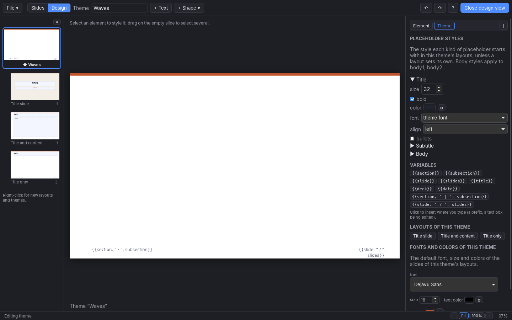

# Themes and layouts

A **theme** is what a family of slides shares: a background, elements drawn on every slide (a
logo, a footer, a band), its fonts and colors (default font, size, text color, accent,
palette), and the style of each kind of
placeholder (title, subtitle, body). A **layout** belongs to a theme and gives one
arrangement of placeholders: title slide, title and content, two contents… It keeps **only
what it changes** of its theme, so a change to the theme reaches every layout that did not
change that very thing, and anything a layout changes shows as an override that one click
takes back.

A slide names its layout. A deck can have several themes, for instance after pasting slides
from another deck.

## Choosing a slide's layout

- Right-click a thumbnail, **Layout ▸**, and pick one (the list is grouped by theme). To give
  several slides the same layout, pick them first with Ctrl+click or Shift+click on their
  thumbnails.
- The right panel shows the slide's layout, with a selector to change it. Changing it keeps
  the slide's elements: the text boxes that fill a placeholder move to where the new layout
  puts it, and each placeholder the slide does not fill yet gets an empty text box, showing
  the placeholder's name, ready to type in. Adding a placeholder to a layout in the design
  view does the same on the slides that use it.
- **New slide** (right-click a thumbnail) creates the next slide from that slide's layout:
  one text box per placeholder, at the placeholder's position and in its style, showing the
  placeholder's name.

## The design view

Themes and layouts are edited in the **design view**, as PowerPoint's slide master view:
**Design** in the header (or **Design view…** in the Slide tab) opens it on the current
slide's layout; **Slides**, or **Close design view**, returns to the slide.



- **On the left**, instead of the slides: each theme (◆), with its layouts under it and, for
  each layout, how many slides use it. Click one to edit it on the canvas.
- **Right-click** in that pane: on a theme or one of its layouts, a **new layout** in that
  theme from PowerPoint's usual dispositions (title slide, title and content, section
  header, two contents, comparison, title only, blank); on either, **rename** it (also by
  double-clicking it; its slides or layouts follow); on a theme, **delete** it (its
  layouts keep their look and lose the theme); on a layout, **save it to a file** or
  **delete** it (its slides keep their elements); anywhere, a **new theme** or **load a
  layout from a file**.
- **The header** holds the name field (renames the theme or layout; slides follow),
  **+ Text**, **+ Shape**, **+ Table** and **+ Placeholder** (a title, a subtitle or a body,
  named `subtitle2`, `body2`… for a second one).
- **The side panel** shows, for a theme, its **placeholder styles** (one per kind: `title`,
  `subtitle`, `body`…; a body style serves `body1`, `body2`…), its **fonts and colors** and
  its layouts; for a layout, its theme and overrides (below) and its own fonts and colors.

### Editing a layout


The canvas shows the layout: its theme's elements, dimmed and not selectable; its own
elements, editable like slide elements; and its placeholders as dashed boxes with their name,
which move and resize the same way. **Double-click** a placeholder to rename it in place
(Enter or a click elsewhere keeps the name, Escape cancels); slides that fill the placeholder
follow the new name.

Selecting a placeholder shows its text style in the Element tab: size, bold, color, font,
alignment, bullets. In a layout with a theme, each field says where its value comes from:

- **theme**: the theme's value, which follows the theme when it changes;
- in bold, with **↺** and **⇪**: set by this layout. **↺** drops the override and returns to
  the theme's value; **⇪** makes this value the theme's, for all its layouts.

A placeholder can also have a **prefix**: text shown before what the slide types in it,
which may hold [variables](variables.md), such as `{{slide}}. ` before a title or
`{{section}} — ` before a subtitle. The prefix is drawn on the slide, in the PDF and in
PowerPoint exports, in the style of the text's first characters, but it is not part of the
slide's text: typing on the slide starts after it. The panel lists the variables; clicking
one inserts it into the prefix field (or into the text being edited, or copies it).

The Layout tab shows the layout's theme (a selector moves the layout to another theme, or to
none, keeping its look), **hide the theme's elements** (for a title slide without the footer,
say), and what the layout changes of its theme, with **Reset to theme** to drop every
override at once. Placeholder positions and the layout's own elements are its own, not
overrides.

### Editing a theme

The canvas shows the theme's background and its elements (a logo, a footer, a band), editable
like a layout's; they are drawn on every slide of its layouts. A new layout joins the theme it
was made in and takes its placeholder styles; a new theme starts with the usual placeholder
styles.

## Fonts and colors

A theme's fonts and colors are a default font, text size, text color, an accent and a
palette of swatches. A layout may change any of them for its slides, the others coming from
its theme; slides without a layout take the deck's first theme's.

- Text, formulas and placeholders that set no font, size or color of their own take these.
  Changing a theme's font restyles every slide of its layouts. Runs keep an explicit style
  wherever one was set; the style bar's ⌀ buttons return to the inherited one.
- The accent is the default highlight of the plan slide and the first swatch; the swatches
  appear as round buttons in the style bar.
- The **Fonts and colors** section of the right panel edits, on a slide, the fonts and
  colors of the slide's theme (its name is in the heading: a change restyles every slide of
  that theme); in the theme editor, the theme's; in the layout editor, the layout's own,
  blank fields taking the theme's.
- Fonts: the bundled families are DejaVu Sans (default), Libertinus Serif, New Computer
  Modern and DejaVu Sans Mono. Any `.ttf` or `.otf` file in the deck's `fonts/` folder is
  loaded with the deck and listed by its family name, so a corporate font travels with the
  deck and the PDF export embeds it. A missing family falls back to DejaVu Sans.

## Variables

A theme's or a layout's texts can hold variables filled per slide, such as a footer
`{{section, " | ", subsection}}` and `{{slide, " / ", slides}}`. The list and the rules are
in [Variables](variables.md).

## Reusing a layout: `.deck_layout`

**Save layout to a file…** (right-click a layout in the design view) writes the layout, merged with its theme so that it
stands on its own, as a folder:

```text
Corp.deck_layout/
  layout.json   # the layout: background, elements, placeholders, fonts and colors
  assets/       # its images
```

**Load a layout from a file…** (right-click in the design view) reads such a folder into the current deck,
copying its images, under its name or a numbered one if the name is taken, and opens it for
editing; it has no theme until one is chosen in its panel. A folder of `.deck_layout` folders
is a layout library. The deck must have been saved once, so that images have a folder to be
copied into. Slides pasted or inserted from another deck bring their layout and its theme
along when the deck lacks them (see [Reusing work](reuse.md)).

## PowerPoint

**Import** makes one theme of each slide master: what all its layouts share (the master's
background, shapes, fonts and colors, and per kind of placeholder the most common style)
goes into the theme, named after the PowerPoint theme, and each layout keeps its
differences as overrides. Date, footer and slide-number placeholders are skipped; a blank
layout is not kept. Slides keep their layout and their placeholder names.

**Export** writes one PowerPoint layout per decker layout, merged with its theme, under one
slide master, plus a blank layout for slides without one. Text boxes that fill a
placeholder are exported as placeholders of that layout, so the deck opens in PowerPoint
with its layouts in the layout gallery; the fonts and colors of the deck's first theme
become the PowerPoint theme
(minor and major font, `dk1` text color, `accent1`–`accent6`).

```bash
deck-convert layouts talk.deck
```

lists a deck's themes, their layouts, what each layout overrides, and its placeholders.

## In `deck.json`

```json
{
  "themes": [
    {
      "name": "Corp",
      "background": "#FFFFFF",
      "style": { "font": "Libertinus Serif", "color": "#223344", "accent": "#AA0000" },
      "elements": [
        { "type": "shape", "rect": { "x": 0, "y": 500, "w": 960, "h": 40 }, "fill": "#102030" }
      ],
      "placeholders": [
        { "name": "title", "rect": { "x": 0, "y": 0, "w": 0, "h": 0 }, "size": 40, "bold": true },
        { "name": "body", "rect": { "x": 0, "y": 0, "w": 0, "h": 0 }, "size": 22, "bullets": true }
      ]
    }
  ],
  "layouts": [
    {
      "name": "Title slide",
      "parent": "Corp",
      "background": "#F3EEE6",
      "hide_theme_elements": true,
      "placeholders": [
        { "name": "title", "rect": { "x": 80, "y": 170, "w": 800, "h": 90 },
          "size": 48, "align": "center", "own": ["size", "align"], "prefix": "{{slide}}. " }
      ]
    },
    {
      "name": "Title and content",
      "parent": "Corp",
      "placeholders": [
        { "name": "title", "rect": { "x": 40, "y": 30, "w": 880, "h": 80 } },
        { "name": "body1", "rect": { "x": 40, "y": 130, "w": 880, "h": 340 } }
      ]
    }
  ]
}
```

A theme's `style` holds its fonts and colors. A layout's `parent` names its theme; its
`background`, `theme` (the fonts and colors it changes) and elements
are its own; a placeholder's `own` lists the style properties it sets itself, the others
coming from the theme's placeholder of the same name or kind; its `prefix` is drawn before the
slide's text. Decks of older formats are converted
when opened: before themes (version 1), their layouts become one theme named "Theme", with
what they share moved into it; before version 3, the deck-wide fonts and colors (a top-level
`theme`) are merged into its themes.
