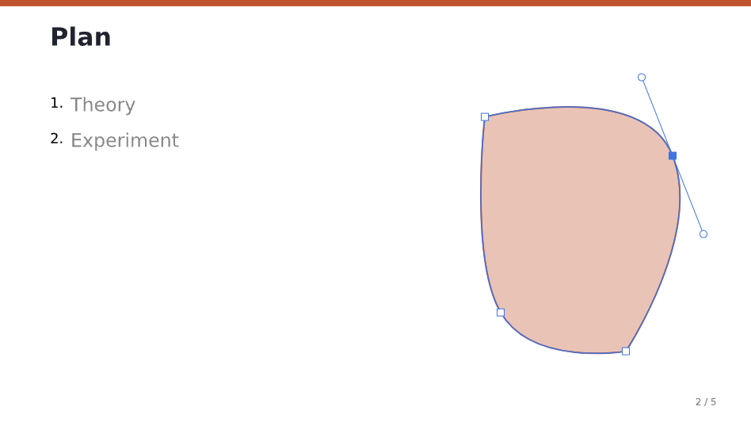

# Shapes, pictures and media

## Shapes

**+ Shape** adds a rectangle, an ellipse, a line or an arrow in the theme's accent color. The
style bar sets its fill and outline; the [arrange bar](arranging.md) its stroke color and
width, and mirrors it (a line or arrow changes direction). Double-click a rectangle or ellipse
to write text in it. Lines and arrows are grabbed along the line itself.

## Paths: freehand and Bézier

The **+ Shape** menu also draws paths:

- **Freehand**: drag on the slide to draw. The stroke is simplified and smoothed into
  curves; ending near where it started closes it into a shape.
- **Bézier path**: click to place a corner, click and drag to place a smooth point with its
  handles. Click the first point (shown in yellow) to close the path into a shape; Enter,
  Escape or a double-click ends it open.

A closed path is filled (the style bar's fill), an open one is a line (the arrange bar's
stroke). Double-click a path, or **Edit points** in its panel, to edit it: drag a point, or
the handles of the selected point (a smooth point keeps its two handles in line; hold Alt to
break them); double-click a point to turn it into a corner or a smooth point; Delete removes
the selected point; Escape or a click away from the points ends editing. The panel's
**closed** box joins or separates the ends. A path moves, resizes, rotates, mirrors and
animates like any shape, its points following its box. In PowerPoint it is a freeform shape,
both ways; in `deck.json` a shape of `kind` `path` with its `path` points (in fractions of its
box, with `in` and `out` handles) and `closed`.

## Pictures

Paste a picture from the clipboard (Ctrl+V, a screenshot for instance) or drop image files
from the file manager onto the canvas, where they land centered under the cursor at their
pixel size, scaled down to fit half the slide (tiny icons are scaled up). PNG, JPEG, GIF,
WebP, BMP and SVG are accepted.

The file is copied into the deck's `assets/` folder. An unsaved deck keeps it in a temporary
folder until **Save as** moves everything to the chosen one. Saving removes from `assets/` the
files no element uses any more.

With a picture selected, the side panel offers the crop: a shape to clip to (rectangle,
ellipse, rounded rectangle with its corner radius) and the percentage cut off each edge; the
kept part fills the box. Resizing, cropping, masking or mirroring never changes the file:
those are properties of the element, so two copies of one picture can be cropped differently.

## Videos and animated GIFs

Videos (`mp4`, `webm`, `mov`) and animated GIFs are added like pictures: dropped, pasted, or
picked with **+ Video…**. The panel sets:

- when they play: as soon as they appear (on entering the slide, or at their appear step),
  or on the play button drawn over them;
- whether they loop, or play once and stop on the last frame;
- for videos, whether the sound is on (off by default);
- for videos, the poster: **Use as poster** keeps the frame at the chosen time. A GIF's
  poster is its first frame.

They play in the audience window; the editor and the presenter's previews show the first
frame. Thumbnails and PDF show the poster with a play glyph; PowerPoint gets the clip itself
(see [Exporting](export.md)).
