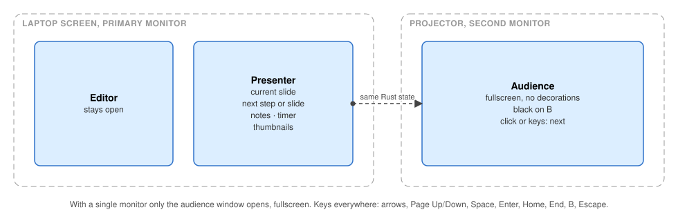

# Presenting with decker

**Present** opens the audience window fullscreen on the projector (the first monitor that is
not the primary one) and the presenter window on the laptop screen. With a single monitor,
only the audience window opens.

The presenter window shows the current section, the current slide, what the next press of a key will show (the
next build step or the next slide), the notes with adjustable text size, an elapsed-time
counter and the clock, and a strip of thumbnails to jump anywhere. **Pointer** (or the P
key) mirrors the mouse over the current slide as a red dot on the audience window: point at
the miniature, the audience sees the dot at the same place. **Pen** (or D) draws instead:
drag over the miniature and the strokes appear on the audience window; they are erased with
C, or when the slide or step changes, and are never saved.

Keys work in every window, so a clicker does too:

| Key | Action |
| --- | --- |
| Right, Down, Page Down, Space, Enter, click | Next step or slide |
| Left, Up, Page Up, Backspace, right click | Previous step or slide |
| Home, End | First, last slide |
| B, `.` | Black screen on and off |
| W, `,` | White screen on and off, to write on a whiteboard under the projector |
| Escape | End the presentation |

Both windows draw the same state, so they can never disagree. To present a PDF made
elsewhere, use [decker-viewer](viewer.md).
