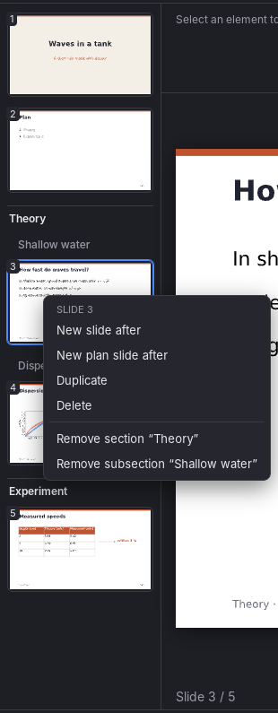

# Slides and sections

## The thumbnail pane

The left column lists the slides. Click one to edit it.

- **Reorder** by dragging a thumbnail, or with Ctrl+Up and Ctrl+Down on the current slide.
  Sections move with the slide that starts them.
- **Right-click a thumbnail** for its menu: new slide or new plan slide after it, duplicate,
  delete, and start or
  remove a section or subsection there. A duplicate belongs to its original's section.
- **Right-click between or below thumbnails** to add a new slide, a new plan slide, a new
  section or a new subsection at that place. A section always starts at a slide, so a new section or
  subsection comes with its first slide, its name ready to type.
- A new slide starts from the [layout](layouts.md) of the slide before it: one text box per
  placeholder.
- Page Up and Page Down change slide.

## Sections

A slide can start a **section** and a **subsection**: two names on the slide. The pane shows
them as headers above the slide that starts them. Hover a thumbnail and click **+ section** or
**+ sub** to start one there; click a header to rename it, clear the name to remove it. The
side panel has the same two fields, and `deck.json` stores them (`"section": "Method"`,
`"subsection": "Model"`). The outline follows the slide order, so moving slides keeps it
consistent.

Sections are used in four places:

- **PDF bookmarks**: sections, subsections under them, and every slide by its title (see
  [Exporting](export.md)).
- **PowerPoint sections**: import maps PowerPoint's sections onto the slide that starts each;
  export writes them back. PowerPoint has no subsections, so those stay decker-only.
- **The presenter view**, which shows the current section and subsection.
- **Layout variables** such as `{{section}}` in a footer (see [Variables](variables.md)).

## The plan slide

**New plan slide** (right-click a thumbnail, or between thumbnails) adds a slide holding an
outline: the list of sections, numbered, the
section the slide belongs to in bold and the others in gray, with the subsections of the
current section under it (the current subsection in bold). The highlight follows the slide's
position in the deck, so build the plan slide once, duplicate it and drag a copy to the start
of each section: every copy marks its own section, and reordering slides keeps them right.
Its size and colors are set in the style bar; the highlight defaults to the theme's accent.
In PowerPoint export each copy becomes a plain text box with the text it shows.

## Speaker notes

The side panel's **Notes** field holds the slide's speaker notes. They show in the
[presenter view](presenting.md), in the PDF handout, and next to an exported PDF for the
[viewer](viewer.md).
