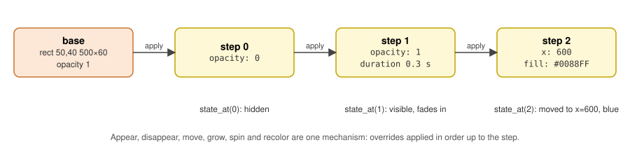
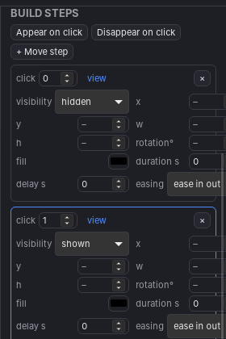

# Build steps

A slide can reveal itself click by click. An element has a base state, and at any click it
may change: appear, disappear, move, grow or shrink, rotate, change color. During the show,
each press of a key plays the next click; a slide consumes as many clicks as its highest step
before the next slide comes.

| Effect | What the step sets at click N |
| --- | --- |
| Appear, fade in | opacity 1 (with opacity 0 at click 0) |
| Disappear | opacity 0 |
| Fly in | position, from off the slide to its place |
| Grow, shrink | size |
| Spin | rotation |
| Color change | fill |
| Move | position |

A group's steps apply to the group as a whole: its children fade, move, grow or spin
together, while keeping steps of their own.

## In the editor

Select an element: the **Build steps** panel lists its steps with everything they change, and
offers **Appear on click** and **Disappear on click**. The ◀ ▶ controls under the canvas show
the slide at a given click; viewing click 1 or later, dragging, resizing or rotating an
element sets where it is at that click, creating a step if there is none (**+ Move step** does
the same from the panel). Each step's visibility, position, size, rotation, fill, duration,
delay and easing are editable in place; **view** shows that click.

In `deck.json` each step has `at` (the click that triggers it), `set` (what changes),
`duration`, `delay` and `easing`.

## In exports

- **PDF** can carry one page per click (see [Exporting](export.md)).
- **PowerPoint** gets appear and disappear steps as fade entrances and exits; other changes
  are reported as warnings.

Not covered, by design: curved motion paths (use intermediate steps), per-character text
effects, looping animations.
