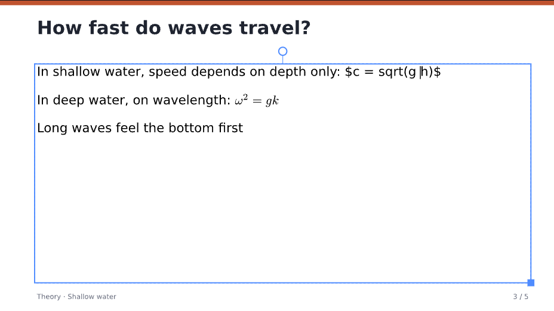

# Text

Text boxes are typeset by Typst, embedded in the application: line breaking at the box width,
bold, italic, size, color and font per run, alignment, bullets by level, and inline formulas.
The editor, the projector, the thumbnails and the PDF therefore show the same lines. Text
defaults to the [theme](layouts.md#fonts-and-colors)'s font and size,
DejaVu Sans at 18 pt when none is set.

## Typing in place

**+ Text** adds a text box. Double-click a text box to edit its text where it is drawn, with a
caret inside the typeset text:

- type, Backspace and Delete, Enter for a new paragraph;
- arrows, Home and End; Shift with any of those for a selection; Ctrl+A;
- with the mouse: click places the caret, dragging selects, a double click selects the word
  and a triple click the paragraph, Shift+click extends;
- Escape, or a click anywhere outside the box being edited, to finish; that click then acts
  as usual (it selects what it lands on, or starts a rubber band).

Typing continues the style of the character before the caret. Pasting text while editing
inserts it. The side panel also shows the text, one paragraph per line.

## Styles

With a text box selected, the style bar above the canvas sets bold, italic, size, color,
font, alignment and bullet level: of the selection while editing, else of the whole box.

- **Horizontal alignment** (left, center, right, justified) belongs to paragraphs: while
  editing, it applies to the paragraphs the selection touches.
- **Vertical alignment** (top, middle, bottom) belongs to the box, a text box or a shape: it
  places the whole text at the top, the middle or the bottom of the box. Text taller than a
  middle-aligned box overflows above and below; a bottom-aligned one, above. PowerPoint calls
  it the text anchor, and it is kept on import and export. A layout's placeholders have one
  too (see [Themes and layouts](layouts.md)): boxes made from them start with it.

Ctrl+B and Ctrl+I work too. The round swatches are the theme's palette; the ⌀ buttons return
to the theme's default. The box's own fill and outline are set there as well.

## Formulas in text

Typing `$...$` in any text box makes an inline formula: `the angle $alpha$ is small`.
Formulas use [Typst math](https://typst.app/docs/reference/math/), which names symbols
without a backslash, but LaTeX's habit works too: `$\alpha + 2\pi$` reads as
`$alpha + 2 pi$`. A lone `$` (a price) and `\$` stay text. Other LaTeX commands such as
`\frac{a}{b}` are not translated: write `a/b` or `frac(a, b)`. **Alt+=** types the two
dollars and puts the caret between them. When the caret moves into a formula, the formula
shows as its source, dollars included, so it can be edited character by character; it is
typeset again as soon as the caret leaves it. For a display formula on its own, see [Formulas and figures](formulas.md).

## Fonts

The bundled families are DejaVu Sans (default), Libertinus Serif, New Computer Modern and
DejaVu Sans Mono. Any `.ttf` or `.otf` file in the deck's `fonts/` folder is loaded with the
deck and listed by its family name, so a corporate font travels with the deck and the PDF
embeds it. A missing family falls back to DejaVu Sans.
